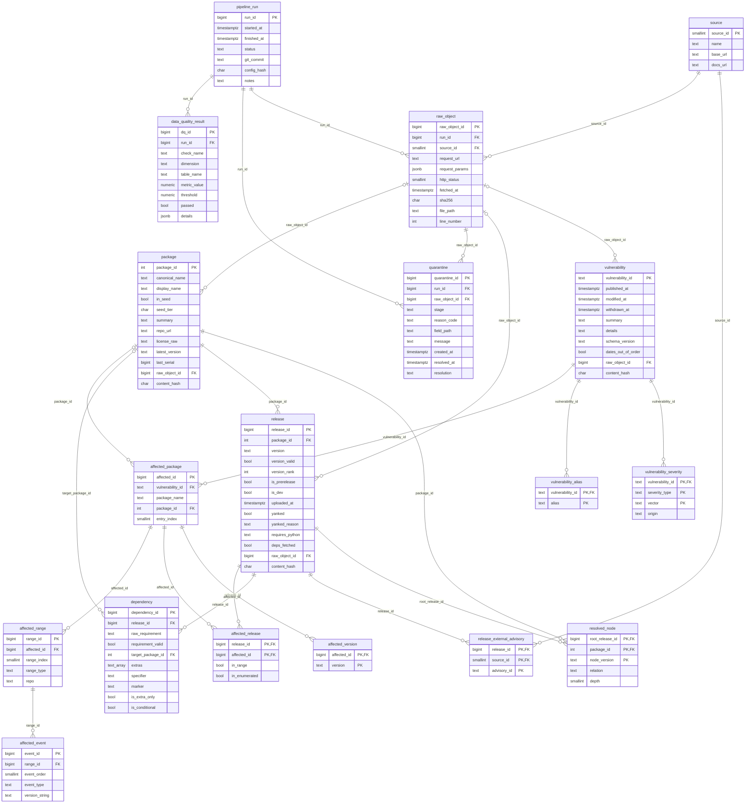

# Entity-relationship diagram

Generated from the live database schema by `scripts/generate_er_diagram.py`, so it matches `migrations/` exactly. Do not edit by hand; re-run the script.

Notation: `PK` primary key, `FK` foreign key. A relationship line reads *parent one-to-many child*; a `|o` on the parent side means the foreign key is optional (nullable).

## Tables

- **Operational (one row per run or response):** `source`, `pipeline_run`, `raw_object`, `quarantine`, `data_quality_result`
- **Packages and releases:** `package`, `release`, `dependency`, `resolved_node`, `release_external_advisory`
- **Advisories:** `vulnerability`, `vulnerability_alias`, `vulnerability_severity`, `affected_package`, `affected_range`, `affected_event`, `affected_version`, `affected_release`

Frames never carry surrogate ids: the loader resolves natural keys to the ids above (see `docs/interfaces.md`).
